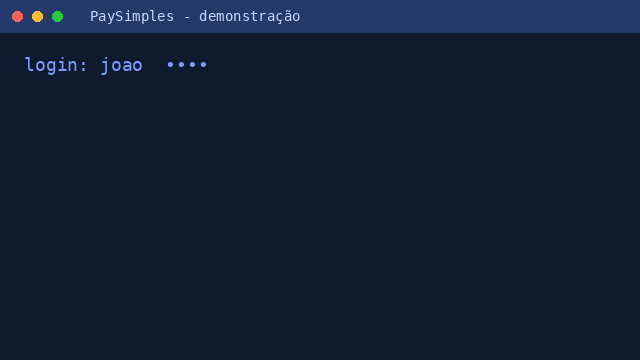
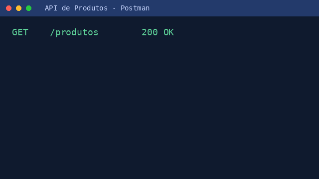
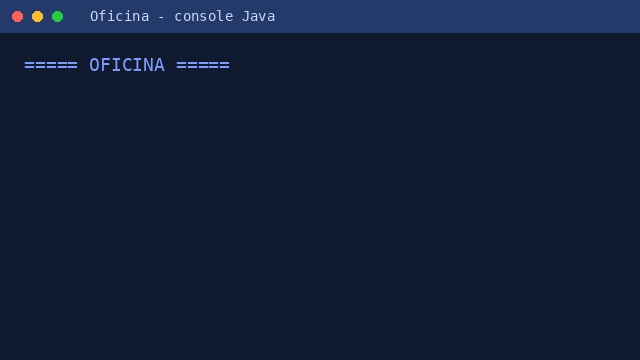
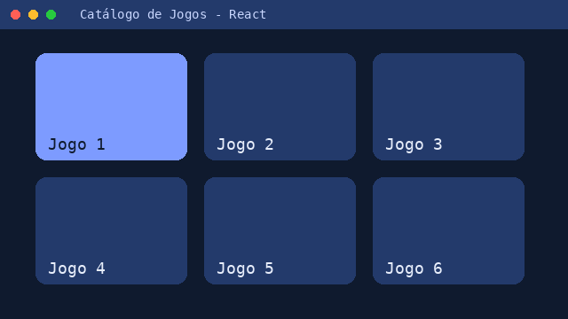

# Portfólio Profissional · Aurélio Silva 👨‍💻

> [!NOTE]
> Website de portfólio profissional, moderno e responsivo, para apresentar trajetória, projetos, experiências e formas de contato.

<p align="center"></p>

Este projeto foi desenvolvido como trabalho da disciplina de Desenvolvimento e Integração de Aplicações Web. O site é uma aplicação **React + Vite** hospedada gratuitamente na **Vercel**, com seções acessadas por menu de navegação, versão em português e inglês e formulário de contato com envio de e-mail via EmailJS.

## 🚧 Status do Projeto

    

## 📚 Índice

- [Links Úteis](#-links-úteis)
- [Sobre o Projeto](#-sobre-o-projeto)
- [Funcionalidades Principais](#-funcionalidades-principais)
- [Tecnologias Utilizadas](#-tecnologias-utilizadas)
- [Dependências](#-dependências)
- [Arquitetura](#-arquitetura)
- [Instalação e Execução](#-instalação-e-execução)
- [Deploy](#-deploy)
- [Estrutura de Pastas](#-estrutura-de-pastas)
- [Demonstração](#-demonstração)
- [Testes](#-testes)
- [Documentações utilizadas](#-documentações-utilizadas)
- [Autores](#-autores)
- [Contribuição](#-contribuição)
- [Agradecimentos](#-agradecimentos)
- [Licença](#-licença)

## 🔗 Links Úteis

- 🌐 **Demo Online:** [COLE AQUI O LINK DA VERCEL](https://SEU-PROJETO.vercel.app)
- 💻 **Repositório:** https://github.com/aurelio22112007/SEU-REPOSITORIO
- 🎨 **Wireframes (Figma):** COLE AQUI O LINK DO FIGMA

## 📝 Sobre o Projeto

- **Por que existe:** apresentar minha trajetória, habilidades e projetos de forma profissional e acessível para recrutadores e professores.
- **Problema que resolve:** reúne em um só lugar meus projetos do GitHub, com descrição, tecnologias e demonstração visual, além de canais de contato.
- **Contexto:** acadêmico, trabalho da faculdade com objetivo profissional (busca por estágio).
- **Onde usar:** processos seletivos, LinkedIn/Instagram e currículo.

## ✨ Funcionalidades Principais

- 🧭 **Menu de navegação** com âncoras para Sobre Mim, Projetos, Experiências e Contato.
- 🌎 **Sobre Mim em português e inglês**, com botão para alternar o idioma.
- 🕒 **Linha do tempo de projetos**, do mais antigo ao mais recente, com nome, descrição, tecnologias, link do GitHub e GIF do projeto em funcionamento.
- 💼 **Experiências** com instituição, atividade, período e descrição.
- 📨 **Contato** com ícones clicáveis (WhatsApp, Instagram, GitHub, e-mail) e formulário com validação e envio por e-mail.
- 📱 **Design responsivo** com menu adaptado para celular e tema claro/escuro automático.

## 🛠 Tecnologias Utilizadas

### 💻 Front-end
- **Biblioteca:** React 18
- **Linguagem:** JavaScript (ES6+) e JSX
- **Build Tool:** Vite 5
- **Estilização:** CSS puro com variáveis (design responsivo)
- **Formulários:** React Hook Form
- **Envio de e-mail:** EmailJS
- **Gerenciamento de estado:** Context API (idioma)

### ⚙️ Infraestrutura
- **Hospedagem:** Vercel
- **Versionamento:** Git e GitHub
- **Prototipação:** Figma

## 📦 Dependências

| Pacote | Versão | Uso |
|---|---|---|
| react | ^18.3.1 | Biblioteca de interface |
| react-dom | ^18.3.1 | Renderização no navegador |
| react-hook-form | ^7.53.0 | Validação do formulário |
| @emailjs/browser | ^4.4.1 | Envio de e-mail direto do front-end |
| vite | ^5.4.8 | Servidor de desenvolvimento e build |
| @vitejs/plugin-react | ^4.3.2 | Plugin React para o Vite |

## 🏗 Arquitetura

Aplicação **SPA (single page application)** apenas de front-end, sem back-end próprio:

- **Componentes por seção** (`Header`, `About`, `Projects`, `Experiences`, `Contact`, `Footer`).
- **Dados separados do código** em `src/data`, para editar projetos, experiências e textos sem mexer nos componentes.
- **Context API** para o idioma (PT/EN), usada por todos os componentes.
- **EmailJS** envia o e-mail do formulário direto do navegador, dispensando servidor.
- **Trade-off:** as chaves do EmailJS ficam no bundle do front-end (são chaves públicas, protegidas pelas regras da conta do EmailJS).

## 🔧 Instalação e Execução

### Pré-requisitos
- **Node.js** v18 ou superior
- **npm** (ou yarn)

### 🔑 Variáveis de Ambiente
Copie `.env.example` para `.env.local` e preencha com os dados da sua conta no [EmailJS](https://www.emailjs.com/):

| Variável | Descrição |
|---|---|
| `VITE_EMAILJS_SERVICE_ID` | ID do serviço de e-mail |
| `VITE_EMAILJS_TEMPLATE_ID_FOR_ME` | Template do e-mail que chega para mim |
| `VITE_EMAILJS_TEMPLATE_ID_FOR_SENDER` | (Opcional) Template de resposta automática |
| `VITE_EMAILJS_PUBLIC_KEY` | Chave pública da conta |

Variáveis em projetos Vite precisam começar com `VITE_`. Variáveis de template usadas: `from_name`, `from_email`, `message`, `reply_to` e, na resposta automática, `to_email`.

### 📦 Instalação de dependências
```bash
git clone https://github.com/aurelio22112007/SEU-REPOSITORIO.git
cd SEU-REPOSITORIO
npm install
```

### ⚡ Como executar
```bash
npm run dev
```
🎨 O site fica disponível em http://localhost:5173.

Outros comandos: `npm run build` (gera a pasta `dist`) e `npm run preview` (testa o build localmente).

## 🚀 Deploy

1. Envie o projeto para o GitHub.
2. Na [Vercel](https://vercel.com/), clique em **Add New → Project** e importe o repositório (Framework: **Vite**).
3. Em **Settings → Environment Variables**, cadastre as 4 variáveis `VITE_EMAILJS_*`.
4. Clique em **Deploy** e copie o link gerado para a seção [Links Úteis](#-links-úteis).

## 📂 Estrutura de Pastas

```
.
├── .env.example            # 🧩 Exemplo das variáveis de ambiente
├── .gitignore
├── index.html              # 📄 HTML base do Vite
├── LICENSE
├── package.json            # 📦 Dependências e scripts
├── vite.config.js
├── README.md
├── /public
│   └── logo.svg            # 🖼️ Logo / favicon
└── /src
    ├── main.jsx            # 🚪 Ponto de entrada
    ├── App.jsx             # 🧱 Composição das seções
    ├── index.css           # 🎨 Estilos globais e tema
    ├── /assets/projects    # 🖼️ GIFs dos projetos
    ├── /components         # Header, About, Projects, Experiences, Contact, Footer, Icon
    ├── /context            # LangContext (idioma PT/EN)
    └── /data               # profile, i18n, projects, experiences
```

## 🎥 Demonstração

| PaySimples | API de Produtos |
|---|---|
|  |  |

| Boxes e Ordens (Java) | Catálogo de Jogos |
|---|---|
|  |  |

> Troque estes GIFs por gravações reais de tela dos projetos em execução.

## 🧪 Testes

Testes manuais realizados: navegação entre seções, troca de idioma, responsividade (celular, tablet e desktop), validação dos campos do formulário e envio de e-mail em produção.

## 🔗 Documentações utilizadas

- 📖 [React](https://react.dev)
- 📖 [Vite](https://vite.dev/)
- 📖 [React Hook Form](https://react-hook-form.com/)
- 📖 [EmailJS](https://www.emailjs.com/)
- 📖 [Vercel](https://vercel.com/docs)
- 📖 [Conventional Commits](https://www.conventionalcommits.org/pt-br/)

## 👥 Autores

| 👤 Nome | :octocat: GitHub | 📸 Instagram |
|---|---|---|
| Aurélio Silva | [@aurelio22112007](https://github.com/aurelio22112007) | [@aurelio.silva_](https://instagram.com/aurelio.silva_) |

## 🤝 Contribuição

1. Faça um fork do projeto.
2. Crie uma branch (`git checkout -b feature/minha-feature`).
3. Commit suas mudanças (`git commit -m 'feat: adiciona nova funcionalidade'`).
4. Faça o push (`git push origin feature/minha-feature`).
5. Abra um Pull Request.

## 🙏 Agradecimentos

- **Engenharia de Software PUC Minas** e **Prof. Dr. João Paulo Aramuni**, pelo template de README e orientação do trabalho.
- Ferramentas de IA, utilizadas como apoio ao aprendizado e à organização do projeto.

## 📄 Licença

Este projeto é distribuído sob a Licença MIT.
